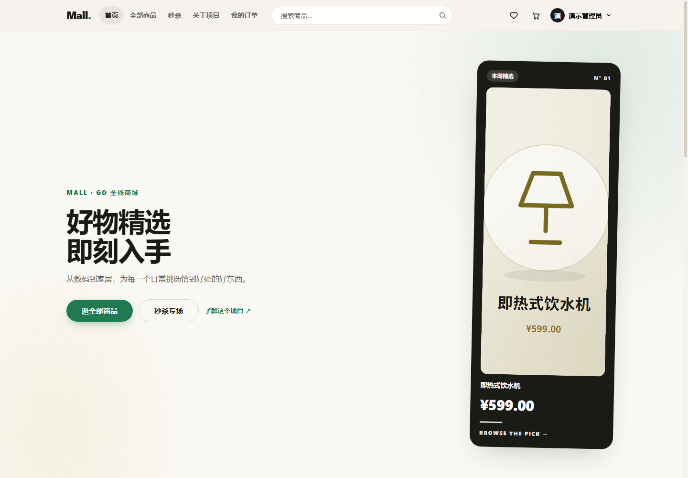
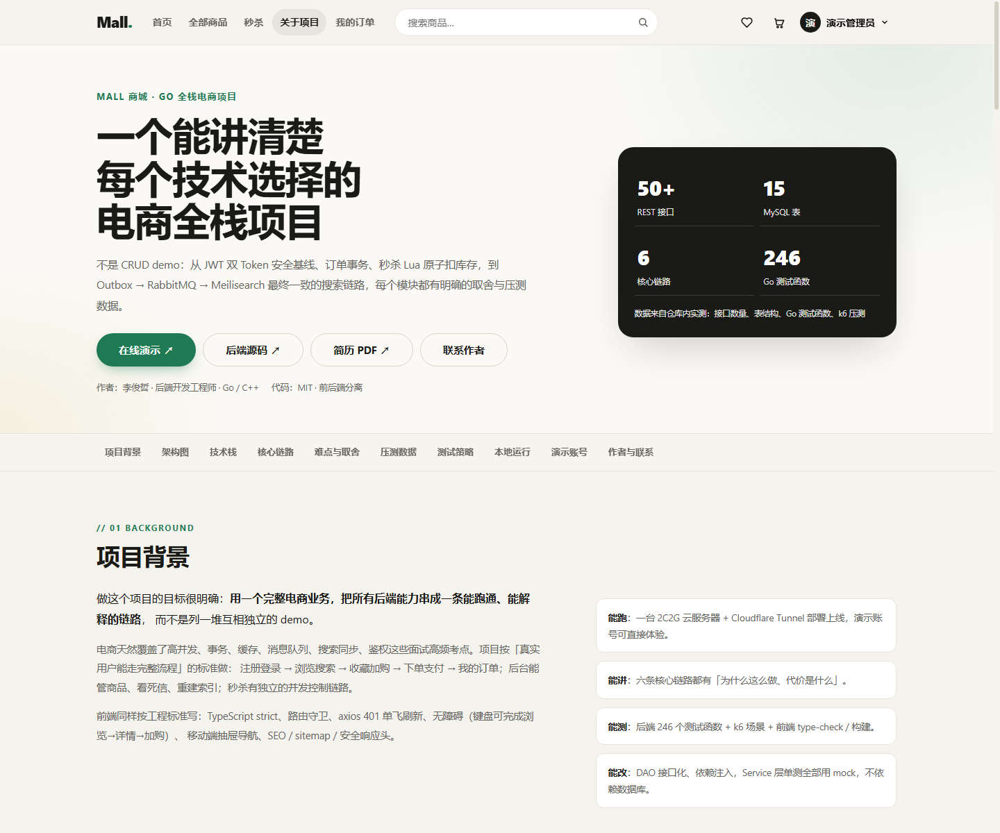
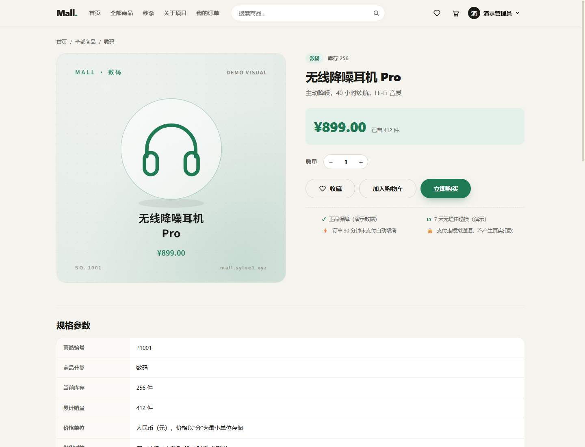
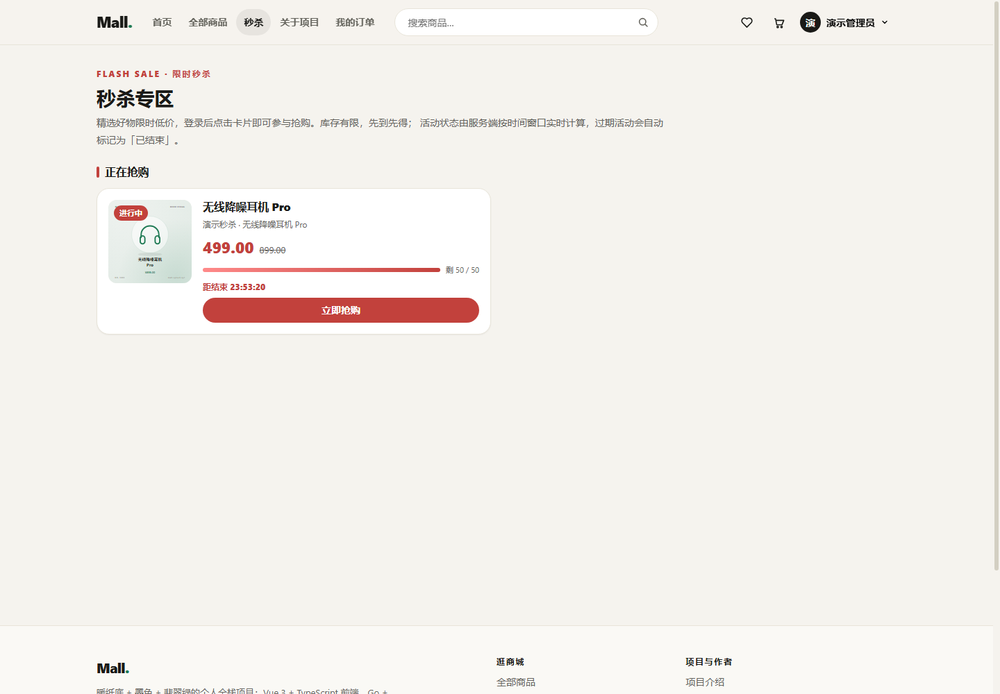
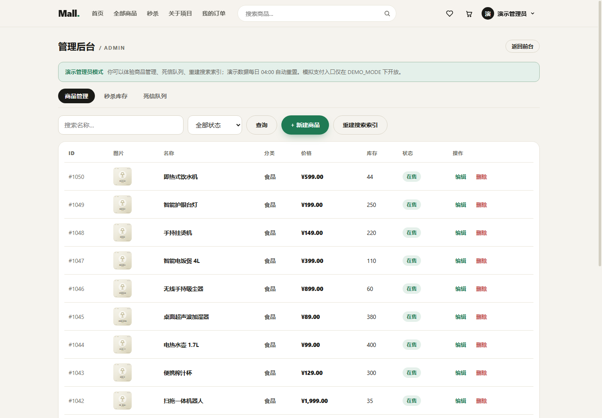

# Mall 商城 · 前端

Vue 3 + TypeScript + Vite 单页应用，对接 [Go + Gin 后端](https://github.com/syloe1/mall)，完整实现电商交易链路与后台管理。

- 🌐 **在线演示**：<https://mall.syloe1.xyz>
- 📖 **项目说明页**（架构 / 六条核心链路 / 压测数据 / 演示账号）：<https://mall.syloe1.xyz/about>
- ⚙️ **后端仓库**：<https://github.com/syloe1/mall>
- 👤 **作者**：李俊哲 · 后端开发工程师（Go / C++）· [作品集](https://syloe1.xyz)

## 页面预览

| 首页 | 项目说明页 |
|---|---|
|  |  |

| 商品详情 | 秒杀 |
|---|---|
|  |  |

| 登录（一键演示账号） | 管理后台 |
|---|---|
|  |  |

## 功能

| 模块 | 能力 |
|---|---|
| 商品浏览 | 首页精选 / 分类筛选 / 分页、全部商品、Meilisearch 全文搜索、商品详情（规格参数 / 服务承诺 / 相关推荐 / 图文详情） |
| 账号 | 注册（前后端一致的密码策略）、登录、个人中心、改资料、改密码、支付密码 |
| 交易闭环 | 购物车（勾选/全选/改数量/清空）、结算、下单、收银台（余额 / 模拟支付）、下单成功、我的订单 |
| 个人增强 | 收藏夹、收货地址管理（CRUD + 默认地址） |
| 秒杀 | 活动列表（状态由服务端按时间窗口实时派生）、倒计时、抢购 + 轮询落单结果、已结束/售罄禁用态 |
| 管理后台 | 商品管理（搜索/筛选/分页/CRUD）、秒杀库存初始化、死信队列、重建搜索索引 |
| 项目说明页 | `/about`：架构图、技术栈、六条核心链路、难点与取舍、压测数据、测试策略、本地运行、演示账号、作者其它项目与联系方式 |

## 技术栈

- **Vue 3.5**（`<script setup lang="ts">`）+ **TypeScript**（`vue-tsc --build`，strict）
- **Vite 8**（路由懒加载分包、`/api`、`/static` 代理）
- **vue-router 4**（登录守卫 / admin 守卫 / 路由级 SEO meta）
- **Pinia**（登录态、购物车角标、分类字典、toast）
- **axios**（Bearer 注入、401 单飞刷新、统一错误文案）

## 快速开始

```bash
npm install
npm run dev        # http://localhost:5175（后端默认代理到 http://localhost:18888）
```

后端可用 Docker Compose 一键启动（见 [后端仓库](https://github.com/syloe1/mall)）：

```bash
# 后端仓库根目录
cp .env.example .env
docker compose up -d
curl http://localhost:18888/api/v1/ping
```

如果后端直接 `go run ./cmd` 跑在 3333：

```bash
MALL_API_TARGET=http://localhost:3333 npm run dev   # Windows PowerShell: $env:MALL_API_TARGET='http://localhost:3333'
```

### 演示账号

| 账号 | 密码 | 角色 |
|---|---|---|
| `demo` | `Demo@123456` | 普通用户（完整体验交易链路） |
| `admin` | `Admin@123456` | 管理员（后台三项能力） |

登录页提供「一键登录」按钮；演示数据每日重置，模拟支付不产生真实扣款。

## 目录结构

```
src/
├── api/            axios 封装 + 按模块 API（auth/http/session/products/cart/orders/payment/seckill/admin/categories/meta）
├── assets/         设计系统（CSS 变量：暖纸底 / 墨色 / 翡翠绿）
├── components/     Header（移动端抽屉）/ Footer / ProductCard / Modal（焦点陷阱）/ Toast / EmptyState / Stepper
├── data/           /about 页面内容数据（核心链路、压测数据、作者其它项目）
├── router/         路由 + 守卫 + 路由级 SEO（title/description/canonical/OG）
├── stores/         user（内存 token + Cookie 恢复）/ cart / categories / toast
├── types/          与后端 DTO 对齐的类型
├── utils/          金额 / 时间格式化、JWT 解码、文案表 humanizeError
└── views/          18 个页面（含 /about 与 admin/AdminView）
scripts/
├── gen_product_images.py   生成自托管商品 SVG 插画（50 件）
├── postbuild.mjs           构建后生成 404.html 并校验 SEO 静态文件
├── prerender.mjs           /about 预渲染（headless Chrome dump-dom）
├── browser_check.mjs       CDP 响应式/交互/控制台错误验收脚本
├── axe_check.mjs           axe-core 无障碍审计（serious/critical = 0）
├── security_audit.mjs      token 存储 / 第三方图片 / Modal 无障碍审计
├── print_resume.mjs        作品集打印为 PDF
└── update_portfolio.py     （运维）更新作品集项目卡片
```

## 工程化细节

- **认证安全**：access token 只存内存；refresh token 走后端 `HttpOnly + SameSite=Lax` Cookie；启动时静默恢复登录态，401 单飞刷新；登出吊销
- **无障碍**：商品卡用 `<RouterLink>` 包裹（键盘可进详情）、Modal `role="dialog" + aria-modal + 焦点陷阱 / ESC / 回焦`、Toast `aria-live`、表单 label 关联、`focus-visible` 焦点环、`prefers-reduced-motion`
- **响应式**：≤900px 汉堡抽屉导航（aria-expanded / aria-controls / ESC / 遮罩关闭 / 焦点回位），375 / 768 / 1024 / 1440 四档回归
- **对比度**：正文灰 `--ink-3` 对纸色 ≥4.5:1；深色卡片文字 100% 白
- **SEO / 分享**：OG / Twitter Card / canonical / theme-color / manifest / apple-touch-icon；`/about` 预渲染；robots.txt / sitemap.xml 真实静态文件；未知路径 nginx 返回真实 404 + 站内 404 页面；`/admin` noindex
- **性能**：路由懒加载分包；商品图自托管 SVG（无第三方图床域名）；首屏 4 张 `fetchpriority="high"`、其余懒加载；图片 `width/height` 防抖动
- **安全响应头**：HSTS / CSP / X-Content-Type-Options / X-Frame-Options / Referrer-Policy / Permissions-Policy / COOP；鉴权接口 `no-store`；公开商品接口短缓存 + `stale-while-revalidate`

## 命令

```bash
npm run dev          # 开发
npm run type-check   # vue-tsc 类型检查
npm run build        # 生产构建（含 postbuild）
npm run prerender    # /about 预渲染（需本机 Chrome）
npm run preview      # 预览构建产物
node scripts/browser_check.mjs <baseUrl> <outDir>   # 多视口交互验收
node scripts/axe_check.mjs <baseUrl>                # 无障碍审计
node scripts/security_audit.mjs <baseUrl>           # 安全/存储审计
```

## 部署

```bash
npm run build
npm run prerender
tar -czf mall-web-dist.tar.gz -C dist .
# 上传到服务器静态目录，Nginx 配置见仓库根目录 mall-nginx.conf
```

`mall-nginx.conf` 包含：静态托管 + gzip + SPA 白名单回退（未知路径 404）+ `/api`、`/static` 反代 + 全站安全响应头 + 缓存策略 + `/admin` noindex。

## License

[MIT](./LICENSE)
